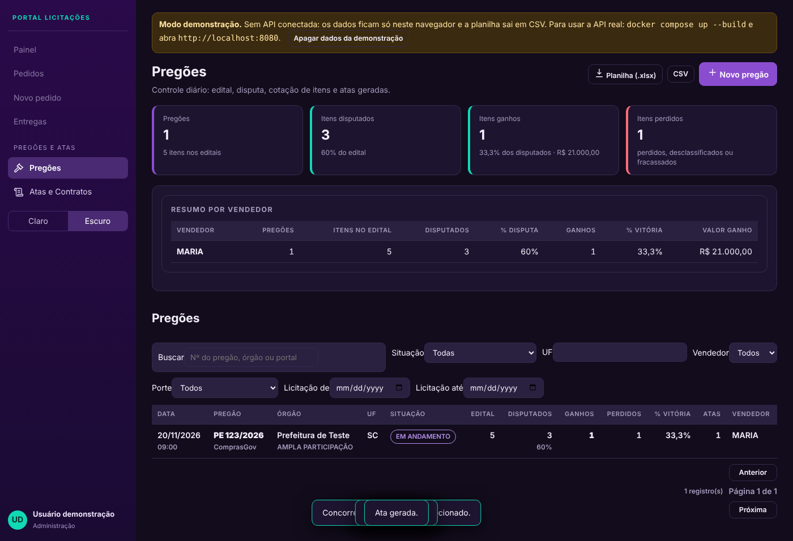
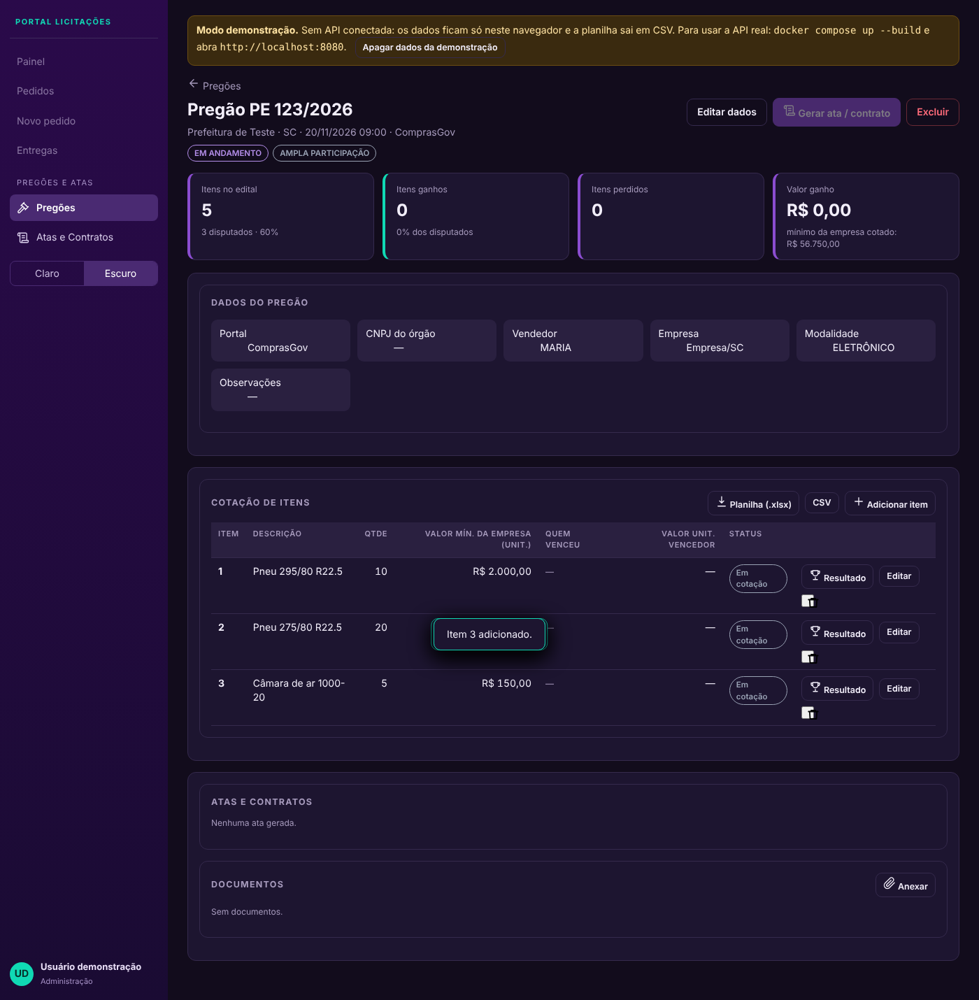
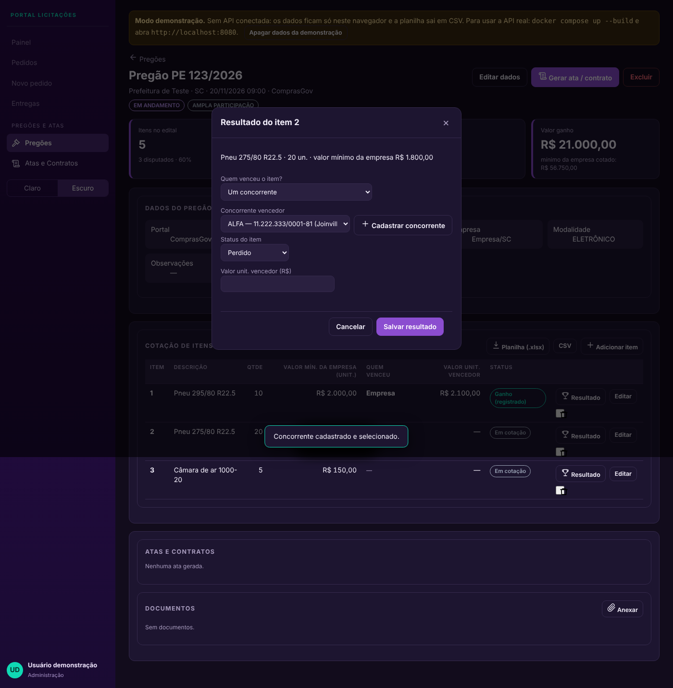
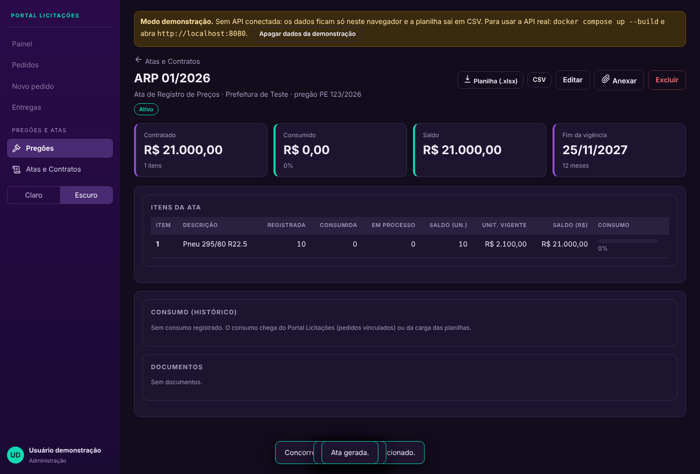
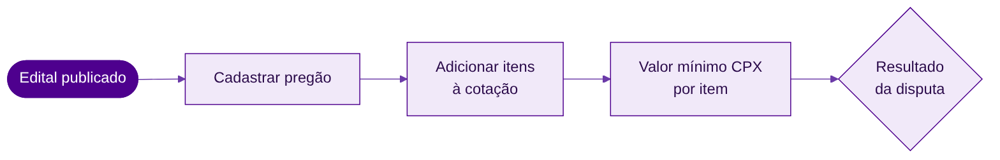
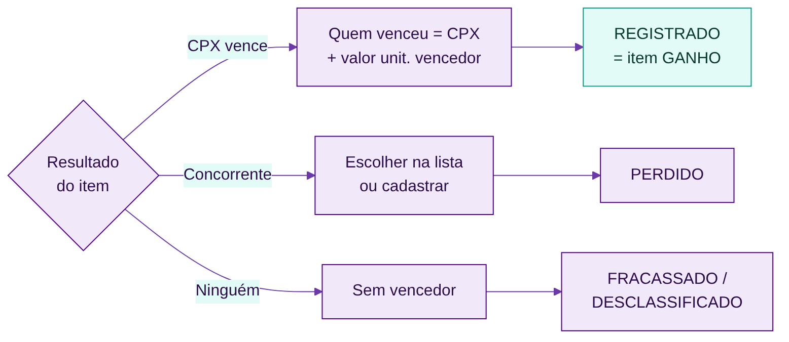
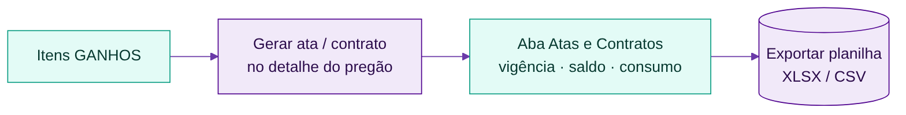

# Pregões e Atas — licitation tracking prototype

🇧🇷 [Leia em português](README.pt-BR.md)

A prototype of a **tender tracking** section and a **contracts and price-agreements management** section, designed to replace shared spreadsheets and folders with one centralized system, with business rules, spreadsheet export and a UI that follows the look and navigation of an internal portal.

> Demo and portfolio project. All data is fictional and the company is generic ("Empresa Demo"). The layout was rebuilt from scratch, without any third-party CSS or logo.

## Screens

| Tender list with summary | Item quotation and result |
|---|---|
|  |  |

| Result with competitor and quick registration | Price agreement and consumption tracking |
|---|---|
|  |  |

## What it does

- **Tenders**: register a tender, quote items with the company's minimum price, record who won each item (competitor list and quick registration with CNPJ validation, including the alphanumeric format), won and lost items, summary per salesperson.
- **Contracts and agreements**: generate an agreement from won items, validity calculation (6/12 months, immediate or custom), balance, consumption per item, attachments and export.
- **Export**: XLSX and CSV spreadsheets, using the same filters as the screen.
- **Rules enforced in the database**: an item becomes "won" only with a winning price informed; an item used in an agreement cannot be removed or un-registered.

## Flow

Tender registration and quotation → result of each item → won items become an agreement → validity and consumption tracking.





Other diagrams: [item lifecycle](docs/img/diagrama_status.png) · [result modal](docs/img/diagrama_resultado.png) ·
[data model](docs/img/diagrama_er.png) · [validity](docs/img/diagrama_vig.png)

## Stack

| Layer | Technology |
|---|---|
| API | FastAPI (Python), Pydantic v2, SQLAlchemy |
| Database | PostgreSQL 16 (constraints, triggers, views and functions) |
| UI | Vanilla JavaScript (ES modules), no framework |
| Infra | Docker Compose |
| Tests | `unittest` (51 tests) |

## How to run

**UI only (no Docker, no database):**

```bash
cd ui
python -m http.server 8080
```

Open `http://localhost:8080/?aba=pregoes` or `?aba=atas`. Without an API, the app runs in demo mode: data is kept in the browser.

**Full system (API + database):**

```bash
docker compose up --build
```

UI at `http://localhost:8080`, API docs at `http://localhost:8080/docs`.

**Tests:**

```bash
python -m unittest discover -s tests
```

## Structure

```
app/          FastAPI API (routes, domain rules, export)
db/           SQL migrations (tables, triggers, views)
ui/           interface (tabs module, API client, demo mode)
scripts/      import of historical spreadsheets
tests/        automated tests
```

## Notes

- The full API was tested against PostgreSQL and the unit tests pass; the full UI flow was validated in a browser in demo mode.
- Integrating into a real portal depends on that platform's HTTP client and authentication; the module was written to plug into it.
