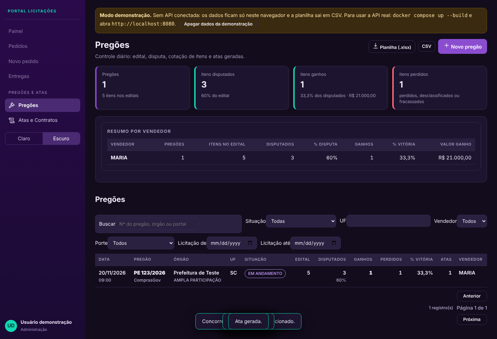
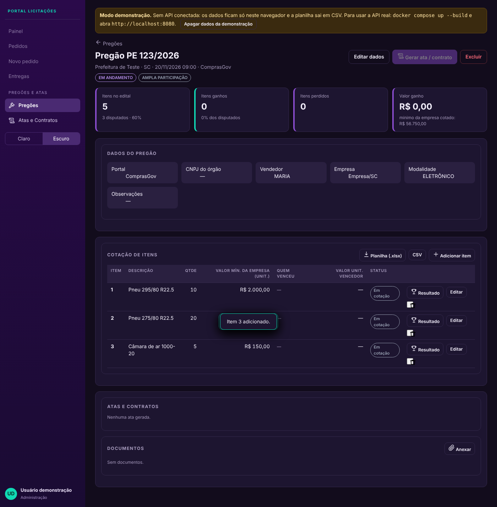
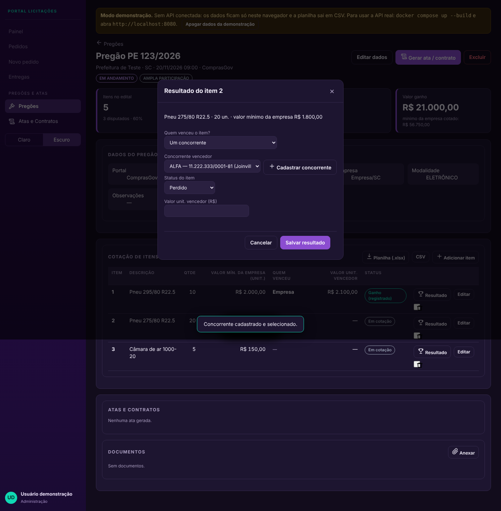
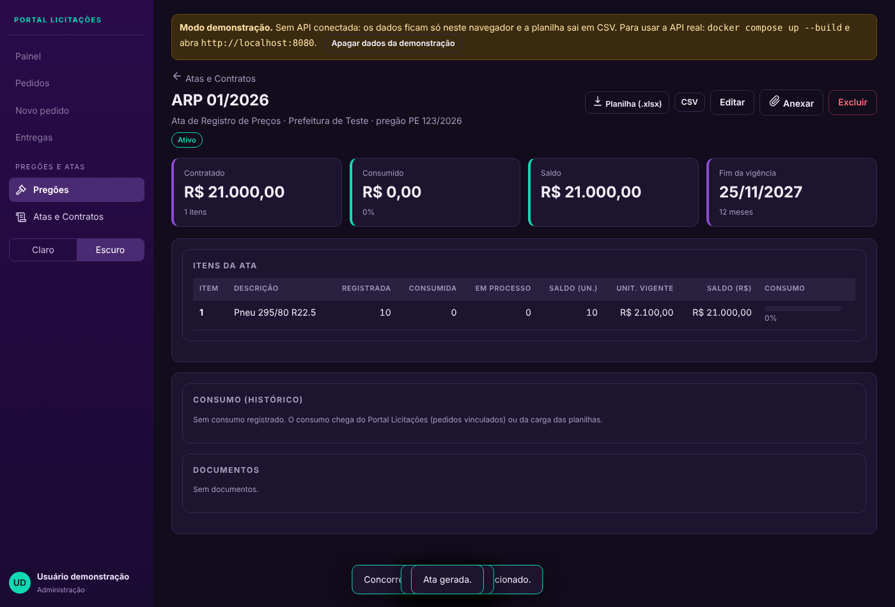
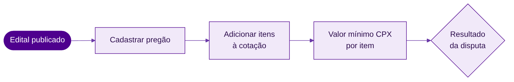
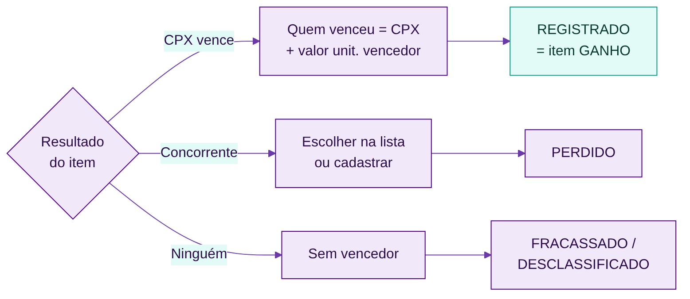
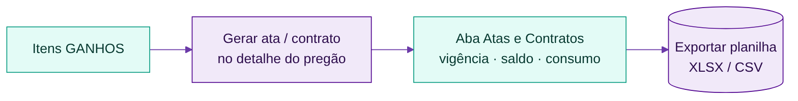

# Pregões e Atas — protótipo de controle de licitações

🇺🇸 [Read in English](README.md)

Protótipo de uma seção de **controle de pregões** e **gestão de atas e contratos**, pensado para substituir planilhas e pastas
compartilhadas por um sistema centralizado, com regras de negócio, exportação para planilha e interface no mesmo padrão visual e de navegação de um portal interno.

> Projeto de demonstração e portfólio. Todos os dados são fictícios e a empresa é genérica ("Empresa Demo"). O layout foi refeito do zero, sem usar CSS nem logo de terceiros.

## Telas

| Lista de pregões com resumo | Cotação e resultado do item |
|---|---|
|  |  |

| Resultado com concorrente e cadastro rápido | Ata e acompanhamento de consumo |
|---|---|
|  |  |

## O que o sistema faz

- **Pregões**: cadastro do pregão, cotação dos itens com o valor mínimo da empresa, registro de quem venceu cada item (lista de concorrentes e cadastro rápido com validação de CNPJ, inclusive o formato alfanumérico), itens ganhos e perdidos, resumo por vendedor.
- **Atas e contratos**: geração de ata a partir dos itens ganhos, cálculo de vigência (6/12 meses, imediato ou personalizado), saldo, consumo por item, anexos e exportação.
- **Exportação**: planilhas XLSX e CSV, com os mesmos filtros da tela.
- **Regras protegidas no banco**: um item só vira ganho com valor vencedor informado; item usado em ata não pode ser removido nem desregistrado.

## Fluxo

Cadastro e cotação do pregão → resultado de cada item → itens ganhos viram ata → acompanhamento de vigência e consumo.





Outros diagramas: [ciclo do item](docs/img/diagrama_status.png) · [modal de resultado](docs/img/diagrama_resultado.png) ·
[modelo de dados](docs/img/diagrama_er.png) · [vigência](docs/img/diagrama_vig.png)

## Stack

| Camada | Tecnologia |
|---|---|
| API | FastAPI (Python), Pydantic v2, SQLAlchemy |
| Banco | PostgreSQL 16 (constraints, triggers, views e funções) |
| Interface | JavaScript puro (ES modules), sem framework |
| Infra | Docker Compose |
| Testes | `unittest` (51 testes) |

## Como rodar

**Só a interface (sem Docker e sem banco):**

```bash
cd ui
python -m http.server 8080
```

Abra `http://localhost:8080/?aba=pregoes` ou `?aba=atas`. Sem API, o sistema entra em modo demonstração: os dados ficam no navegador.

**Sistema completo (API + banco):**

```bash
docker compose up --build
```

Interface em `http://localhost:8080`, documentação da API em `http://localhost:8080/docs`.

**Testes:**

```bash
python -m unittest discover -s tests
```

## Estrutura

```
app/          API FastAPI (rotas, regras de domínio, exportação)
db/           migrações SQL (tabelas, triggers, views)
ui/           interface (módulo das abas, cliente da API, modo demonstração)
scripts/      importação de planilhas históricas
tests/        testes automatizados
```

## Observações

- A API foi testada contra o PostgreSQL e os testes unitários passam; o fluxo completo da interface foi validado em navegador no modo demonstração.
- A integração com um portal real depende do cliente HTTP e da autenticação da plataforma onde for instalada; o módulo foi escrito para isso.
